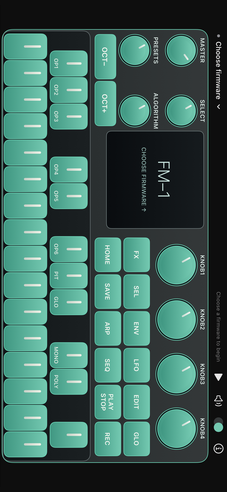

# PocketFM for iOS

Native adaptive landscape FM-1 panel (UIKit/Core Graphics + SwiftUI), with a curated collection of fourteen pinned source-compiled instruments: SLOOP 2.8, Felucca 1.6.1, X0X 1.1.0, Melodee 1.4.5, FM1 Open V14 portable preview, Skiff 1.4, FoMni 0.4, Jangada 1.0.1, CoralFlower 0.5, AMB-1 1.3, GHOULBOX 2.4, LOOM-8 0.9.3, Hortator 0.25.0 and JIANT FM 0.9.9-par12. The consumer interface offers only exact releases backed by a linked native engine. Arbitrary package import, Native/WASM selection, CPU controls and runtime diagnostics are removed from that interface. Existing unsupported files and separate saves remain stored. No factory service, account or telemetry.

Debug research builds retain the experimental WebKit/WASM and reference interpreter backends for local regression work. Release compiles them out, excludes their resources and audits the finished app; see [native store build](docs/native-store-build.md). Signed archive validation and distribution-rights clearance remain separate release gates. See [store preparation](docs/app-store-preparation.md), [native engines](docs/native-firmware-engines.md), [Skiff](docs/native-skiff.md) and [experimental research engine](docs/web-engine.md). See [community instruments](docs/native-community.md) for the six additions, save behavior and exact source pins. No App Store approval is implied.

Unofficial iOS prototype for M-VAVE FM-1. Not affiliated with M-VAVE. Earlier builds were tested on iPhone 12. The six community additions require separate physical-device acceptance after host/simulator validation; this is not an App Store release.



Screenshots document earlier development builds; current palettes were corrected against manufacturer photographs. See [finish references](docs/panel-finishes.md).

## Build

Xcode, Rust and Python 3. No Swift packages or runtime external Rust crates.
Release builds are native-only and require all pinned compiled engines prepared
first. Follow [native family](docs/native-family.md),
[official portable engine](docs/native-official-preview.md),
[Skiff](docs/native-skiff.md) and [native expansion](docs/native-expansion.md).
With the exact local source trees verified, build all fourteen engines:

```sh
rustup target add aarch64-apple-ios aarch64-apple-ios-sim
export FM1_NATIVE_SLOOP="$PWD/Research/NativeSloop/upstream-sloop-2.8"
export FM1_NATIVE_FAMILY="$PWD/Research/NativeFamilyOct22"
export FM1_NATIVE_OFFICIAL_PREVIEW="$PWD/Research/NativeOfficial14/upstream-fm1-open"
export FM1_NATIVE_SKIFF="$PWD/Research/NativeSkiff14/upstream-skiff"
export FM1_NATIVE_EXPANSION="$PWD/Research/NativeExpansion"
export FM1_NATIVE_COMMUNITY="$PWD/Research/NativeCommunityOct27"
./scripts/build.sh simulator
# Unsigned arm64 device build:
./scripts/build.sh device
```

Xcode builds the matching Rust archive before compiling the app. Release uses
`target/store/` and `store-native` with default research features disabled; its
Cargo graph contains no CPU/SoC/ISA interpreter dependencies. Open `FM1.xcodeproj`
and select your signing team for a device/archive. Simulator builds support
Apple Silicon. See [the exact archive recipe](docs/native-store-build.md).

Missing, changed or unprepared pins fail the build rather than silently falling
back. Sources/generated headers and external packages stay under ignored
`Research/`. Optional private interpreter specialization captures are only for
research and are not required by the compiled source engines.

A local Debug research build can additionally compile exact SLOOP 2.8 source for its
pinned package, with the binary interpreter retained for every unmatched package.
Debug also requires the explicitly prepared private pinned `App/WebEngine/engine.wasm`; `scripts/verify_web_engine.py` rejects missing/changed modules and never downloads a replacement. For the pinned SLOOP research backend (build-only Pillow dependency):

```sh
python3 -m venv .venv
source .venv/bin/activate
python3 -m pip install Pillow
python3 Core/native/prepare.py "$PWD/Research/NativeSloop/upstream-sloop-2.8"
FM1_NATIVE_SLOOP="$PWD/Research/NativeSloop/upstream-sloop-2.8" \
  xcodebuild -project FM1.xcodeproj -scheme FM1 -configuration Debug \
  -destination 'generic/platform=iOS Simulator' -derivedDataPath build/Research \
  CODE_SIGNING_ALLOWED=NO build
```

This native backend does not require the optional private static-kernel captures.
The generic Rust interpreter and experimental WASM remain available to local
research tools. The consumer app rejects unmatched packages.

This addresses the recorded-sequencer CPU bottleneck. The source-native backend
has GPL-3.0 notices and a different hardware/main-loop model; see
[docs/native-sloop.md](docs/native-sloop.md) for build pins, save compatibility,
measurements and limits. No native executable-memory JIT is used by these Rust/source-native routes. The opt-in experimental WebKit engine compiles WASM inside its dedicated Worker.

## Play

1. Open the firmware library and choose a supported compiled release. The resource download size is shown before starting; first installation needs a network connection.
2. Downloads are checked against their exact size and SHA-256, then checked against the linked native registry. Arbitrary Files import is not offered in the consumer app.
3. Play chords on the 27 keys; drag knobs vertically; hold hardware buttons for firmware-specific combinations. Tap the LCD to enlarge it.
4. The remembered/default supported installed firmware starts automatically. Pause/resume with the top transport; an explicit pause survives background/foreground transitions within the running app. Master controls the firmware's ADC. The speaker control is a separate output mute.
5. Each release keeps its own saved sounds. Leaving the foreground temporarily pauses audio; returning resumes it unless explicitly paused. System interruptions and removed outputs retain their own resume rules. Previous research-engine saves and unsupported packages are preserved but not exposed as playable choices.
6. Use the side arrow to collapse/restore the transport, and Panel color to select one of six finishes. About contains playing, storage, privacy and license information. CPU frequency and execution-mode controls are not part of the consumer interface.
7. The folder below the side arrow opens Projects and files, including when the header is collapsed. Its native glass controls and surrounding sheets follow the selected panel finish. SLOOP supports named project copies, checked import/export and workspace backups with recoverable deletion, WAV/AIFF/M4A/MP3 waveform trim, converted-sound preview and import into USR1–4 with direct track assignment, and stereo WAV rendering from a separate copy of the current project. MIDI-file export and live recording remain unavailable. See [file workflows and limits](docs/project-files.md).

The current development bundle includes catalogue metadata, not external firmware packages. It downloads exact selected releases on demand. The source-native implementations are already compiled into the signed application; downloaded package instructions are not executed by this native-only flow. Final store packaging, self-contained first launch, privacy URLs and redistribution rights remain explicit release gates. FM1 Open Preview uses the manufacturer's portable sound engine, may differ from the hardware and does not include its original factory sound bank.

## Check

```sh
cargo test --workspace --release
xcodebuild -project FM1.xcodeproj -scheme FM1 -destination 'platform=iOS Simulator,id=YOUR_SIMULATOR' -derivedDataPath build -parallel-testing-enabled NO CODE_SIGNING_ALLOWED=NO test
# Local files only, ignored by Git:
cargo run -p fm1-ios-core --release --example firmware_smoke -- /path/to/Firmware.fwsc
```

The smoke test runs the actual binary, presses/releases a note, checks a nonblank LCD and nonzero audio, round-trips flash and writes a WAV beside the input. It measures desktop interpreter throughput, not iPhone latency or listening quality.

Choose Panel color for the six manufacturer finishes; the choice persists. The native touch layout uses the available screen area instead of fixed physical proportions.

The side chevron hides or restores the top controls; the choice persists and
playback continues. Hiding the row gives the panel more height and enlarges the
LCD where space permits. Each finish has matching lamp/pressed-key colors and
contrasting legends; firmware-generated LCD colors remain unchanged. Static
panel artwork is cached by size, screen scale and finish, while LCD, LEDs and
knob markers update as separate compositing layers.

The generic interpreter exceeds the real-time CPU budget for Felucca and SLOOP. Optional build-time specializations substantially reduce that cost while retaining exact interpreter fallback for other code. See `docs/performance-next-step.md` for the architecture and `docs/performance-lab.md` for controlled simulator measurements; simulator timing is not physical iPhone timing.

See `docs/research.md` and `docs/verification.md` for evidence and remaining work. This is a local development prototype, not a Software Factory `ready` receipt or App Store release.

## License and attribution

This project is distributed under GPL-3.0-only; see [LICENSE](LICENSE). The source-native wrapper and state tooling derive from Virtual FM-1, and the pinned SLOOP firmware is GPL-3.0-only. The vendored fm1-emu interpreter retains its MIT license. Individual upstream components retain their original licenses and notices; see [NOTICE](NOTICE), [interpreter provenance](Vendor/UPSTREAM.md) and [native-backend attribution](App/NOTICE-native-sloop).

No firmware binaries, factory sound banks, private saved projects, generated kernels, device builds or signing credentials are included. Public upstream source/resources are fetched by the opt-in native preparation step. Firmware and third-party asset rights remain with their authors. Publishing this source does not establish App Store approval or grant rights to redistribute arbitrary firmware.
